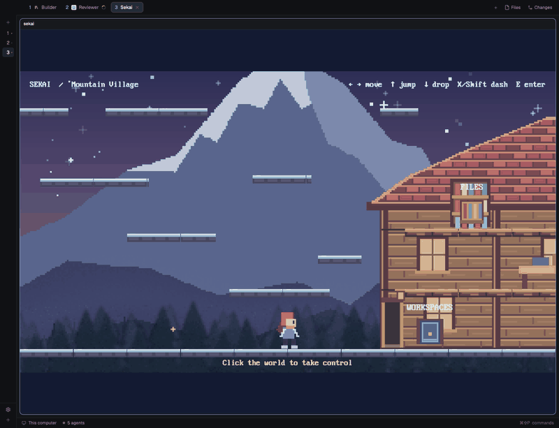
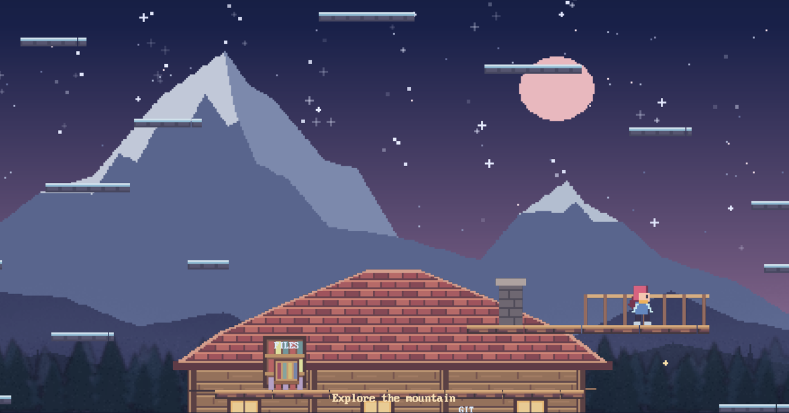
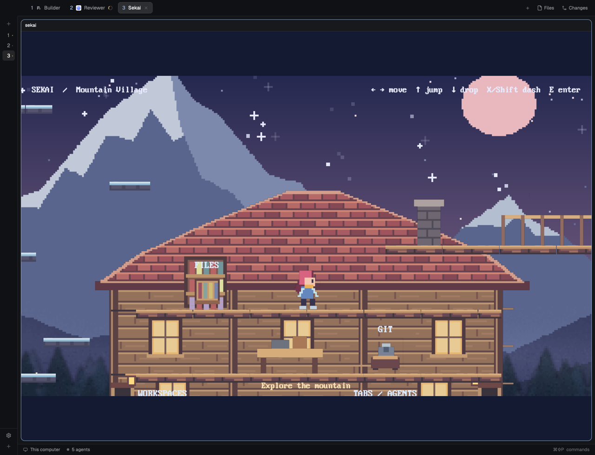
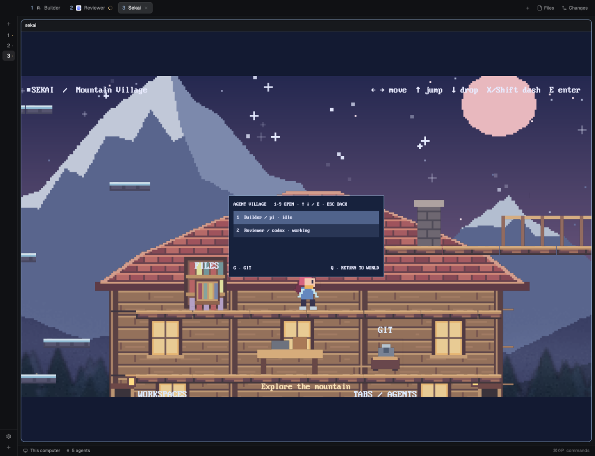
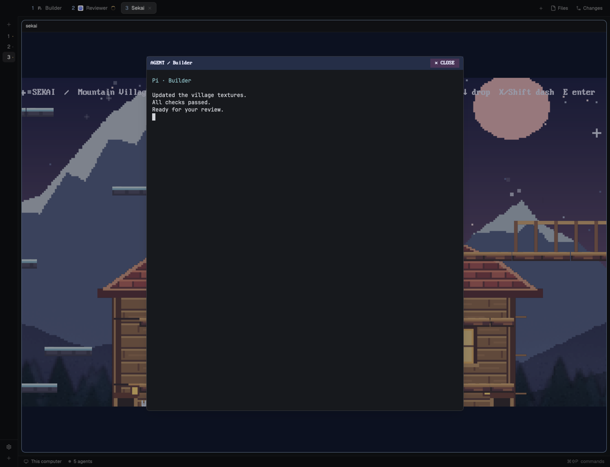
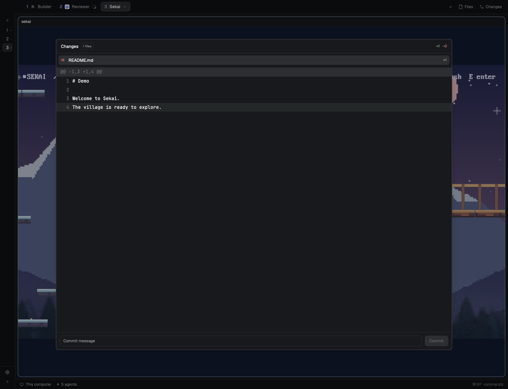

# Sekai

Sekai turns a Herdr workspace into a small, playable pixel-art world. Instead of moving between tabs to inspect agents and repositories, walk through a mountain village, open an agent's live terminal, review Git changes, and return to the world without interrupting the session.

Sekai is built for [Herdr Desktop](https://github.com/herdrdev/herdr-app). All assets, terrain, and improvements are made to be agentically customizable via the Command Block — have fun with your own pixel vibey world!



The 13-second playthrough shows movement, jumping, dashing, the agent picker, an embedded terminal, and the Git changes panel. The recording uses a scripted playthrough of the running mod in a sample workspace, with demonstration terminal output and a sample Git repository rather than private conversations.



## Explore the world

The world is three screens wide and two screens tall. A scrolling camera follows the character through irregular snowy platforms and a timber cottage. Stars twinkle behind the mountain silhouette, mist drifts through the forest, and the balcony provides a panoramic view of the valley.



The cottage contains four functional destinations:

| Destination | Action |
| --- | --- |
| Workspaces | Open the configured Herdr navigation menu. |
| Agents | Choose a live agent in the current workspace. |
| Git | Review changes in the last selected agent's repository. |
| Files | Toggle Herdr's native Files panel. |

The balcony is scenic only: it changes the camera, not the active agent or repository.

## Work with agents without leaving the world

The agent picker lists actual Herdr terminal addresses in workspace order. Selecting an agent opens its existing terminal using Herdr's native terminal renderer in a dialog layout. It does not launch a replacement shell or move the source terminal to a new tab.





An agent's terminal address also determines the Git repository. After closing an embedded session, its ID remains associated with the current Sekai instance. The companion Changes mod resolves the live working directory and machine from that address, then uses the existing Herdr Git interface. An unavailable terminal or unknown working directory is reported instead of silently opening a different repository.



## Controls

| Key | Action |
| --- | --- |
| Left / Right or A / D | Move |
| Up / W / Space | Jump, twice before landing |
| Down / S | Drop through one-way platforms |
| X / Shift | Directional dash, twice before landing |
| E | Interact near an object |
| Ctrl-E | Open the Sekai agent picker |
| 1–9 | Select an agent in the picker |
| Up / Down, then E or Enter | Navigate and select in the picker |
| G | Open Git from the picker |
| Q | Return to the world from the picker |
| Esc | Cancel the picker |

Jump and dash charges are independent, so jump, dash, and jump again is permitted. Landing replenishes both.

With the companion bridge installed, **Ctrl-E → 1–9** switches embedded agents, **Ctrl-E → G** opens Git, and **Ctrl-E → Q** closes the tracked embedded terminal or Git dialog. Ctrl-Space remains the ordinary Herdr navigation shortcut. The global Ctrl-E binding is optional and replaces Ctrl-E's normal behavior in terminals; outside Sekai, the bridge does nothing.

## Installation

The current prototype was developed with Herdr Desktop **0.1.18** on macOS. It uses Herdr's JavaScript/GPUI mod API and the application's built-in terminal renderer.

```sh
git clone https://github.com/vaaldy/sekai.git
cd sekai
mkdir -p ~/.config/herdr-app/mods/sekai
cp *.js mod.json ~/.config/herdr-app/mods/sekai/
cp -R assets ~/.config/herdr-app/mods/sekai/
herdr-app check ~/.config/herdr-app/mods/sekai
herdr-app do tab.new --name Sekai --mod sekai
```

Alternatively, use **Open Sekai** from Herdr's command palette after installing the mod.

The base game and agent picker are contained in this repository. The complete workflow in the demonstration also uses companion Herdr configuration which is not bundled here yet:

- `sekai-bridge`: routes the optional global Ctrl-E shortcut to the correct Sekai instance, including from embedded terminals.
- `sekai-changes`: adapts Herdr's native Changes mod to an explicit terminal address.
- `tab-prefix`: the configured workspace navigation menu and its focus-return integration.

The prototype currently depends on these separately installed mods for their respective shortcuts and panels. If they are absent, the full demonstration workflow is not available. Do not overwrite an existing Herdr key configuration simply to install the base game.

## Development

Sekai uses one shared implementation with independent instances per workspace. Each instance tracks its own character position, world identity, selected agent, and native overlay sessions. This prevents a stale selection from acting on a different workspace or closing the wrong terminal.

```text
main.js             Herdr view lifecycle and composition
world.js            World renderer, atmosphere and camera
world-data.js       Versioned asset catalog and world definition
player.js           Movement, one-way collision and animation
agents.js           Agent picker and native terminal dialogs
identity.js         Instance identity and focus routing
assets/             Original terrain textures and character sprites
tests/              World validation and agent lookup regression tests
status.md           Current architecture and backlog
```

The world definition is the source of both visual placement and collision geometry. Its asset catalog assigns reusable IDs to textures, with dimensions, transparency and tiling metadata. Each world object has an ID, asset reference, position, size, kind and collision type. Portals additionally declare their interaction.

For example, moving the workshop bench only requires changing its object coordinates in `world-data.js`. It is no longer baked into the cottage texture. The validator checks bounds, unique IDs, asset references and portal support before the world is rendered.

```js
{
  id: "workshop-bench",
  kind: "decoration",
  asset: "furniture.workbench",
  x: 618, y: 286, w: 37, h: 24,
  collision: "none"
}
```

The development tests can be run from the repository root:

```sh
node tests/world-data.test.mjs
node --experimental-vm-modules tests/agents.test.mjs
herdr-app check "$PWD"
```

The world tests check the asset catalog, object geometry and rejection of invalid definitions. The agent regression test checks both Herdr's normal agent lookup and the model-pane fallback used if that host binding becomes unavailable.

## Direction

The next step is a creative inventory and a validated command console. Rather than modifying the rendering engine for every layout change, a person or an agent should be able to place, move, remove and reuse objects from the same asset catalog. Undo, persistence and independent world saves remain planned features.

Later, agent chests can become animated characters backed by replaceable sprite packs, while preserving the existing live terminal identity and workflow.

For implementation status and remaining limitations, see [status.md](status.md).
